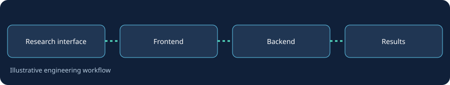
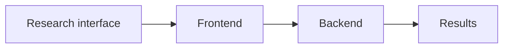
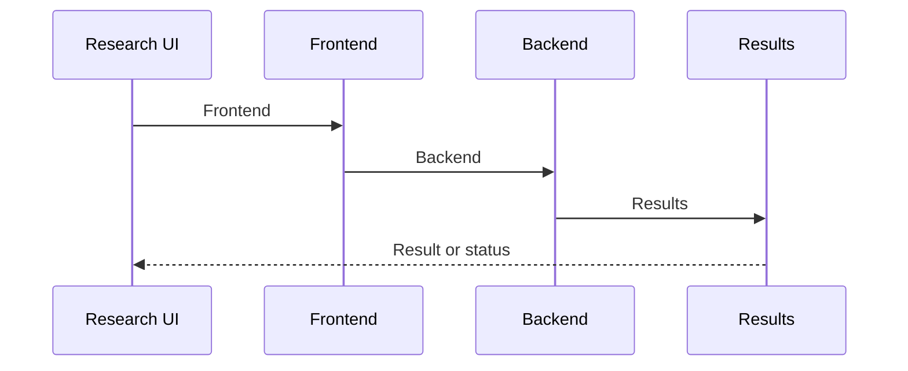

# Nexus Research Engine

<!-- portfolio-visual-start -->
## Engineering overview

 

Illustrative workflow: Research interface → Frontend → Backend → Results. Not live telemetry or proof of production integration.

[Developer profile](https://github.com/ABHILASH9519) · [Issues](https://github.com/ABHILASH9519/Nexus-research-engine/issues)
<!-- portfolio-visual-end -->

Research-oriented frontend and backend workspace. See [design notes](DESIGN.md) and [source](src). Production integration is not verified.

## Technical walkthrough

This sequence is a conceptual review aid, not a recorded execution trace. Consult the implementation and existing run instructions for supported behavior.

 

**Review focus:** frontend/backend organization and design system. This is a conceptual module sequence; end-to-end integration is unverified.
